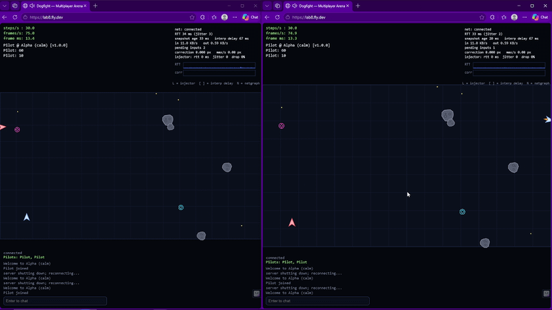

# Dogfight — Лабораторна 08: хмарний деплой, моніторинг та хаос-перевірка

Публічний деплой: `https://lab8.fly.dev` (`APP_VERSION=v1.0.0`, регіон `fra`, внутрішній порт `3000`).



## Запуск

```bash
npm install
npm run build
npm start
```

Для деплою на Fly.io та перевірки ендпойнтів стану:

```bash
fly deploy
curl -s https://lab8.fly.dev/health
curl -s https://lab8.fly.dev/ready
```

## Архітектура та експлуатація

| Компонент / Ендпойнт | Роль у Лабораторній 08 |
| :--- | :--- |
| `Dockerfile` та `fly.toml` | Збирає Node.js/TypeScript-сервер (`PORT=3000`, `HOST=0.0.0.0`, `APP_VERSION=v1.0.0`) і запускає на Fly.io (`force_https = true`, HTTP health check на `/health`) |
| `/health` та `/ready` | Повертають HTTP `200` зі статусом сервісу (`ok` / `ready`) та `version: "v1.0.0"` |
| `/metrics` | Віддає метрики Prometheus для трафіку, підключень і лічильників відмов (`dogfight_rejections_total`) |
| `ALLOWED_ORIGINS` та обмеження | Відхиляє неавторизовані WebSocket-джерела (`Unexpected server response: 400`, `CLOSE 1006`) та обмежує паралельні/флуд-підключення |
| UptimeRobot | Зовнішній HTTP-монітор, який стежить за `https://lab8.fly.dev/health` (`Up` / `200 OK`) |

## Перевірки та результати

| Перевірка | Зафіксований результат |
| :--- | :--- |
| Матч двох гравців (`https://lab8.fly.dev`) | Два клієнти активні в `Alpha (calm)` через `wss://`, `steps/s = 30.0`, `frames/s = 75.0`, `RTT ~ 32–33 ms` |
| Зовнішній моніторинг | Монітор UptimeRobot активний для `https://lab8.fly.dev/health` зі статусом `Up` |
| Чужий `Origin` (`https://evil.example.com`) | За наявності `ALLOWED_ORIGINS="https://lab8.fly.dev"` WebSocket-підключення відхиляється з HTTP `400` (`CLOSE 1006`) |
| Реконект після рестарту сервера (`fly apps restart lab8`) | Підключені клієнти фіксують зупинку/перепідключення та відновлюють стан `connected` у кімнаті |
| Флуд-підключення та ізоляція кімнат | Пакет паралельних WebSocket-флуд-підключень відхиляється з HTTP `400` (`CLOSE 1006`), тоді як активні кімнати залишаються на зв'язку |

## Обмеження та подальші кроки

* Стан кімнат зберігається в оперативній пам'яті без постійного сховища між перезапусками; після перевірок доцільно тримати 1 машину або зупиняти зайві машини Fly.io для збереження безкоштовної квоти.
* У консолі браузера лишаються некритичні повідомлення про відновлення `AudioContext` після дії користувача та відсутність `/favicon.ico` (`404`).
* Подальші кроки: зафіксувати `README.md` та GIF у репозиторії і проставити теги `lab-08` та `v1.0.0`.

## Теги

* `lab-08`
* `v1.0.0`